Hi, I'm Finney, a software developer. At [TradeByBartr](https://tradebybartr.com) I build and manage the frontend of a live digital trading platform. I've also worked on community products, booking systems, commerce and media for clients and teams.

I bring a practical, end-to-end mindset: understanding the problem, implementing the feature, debugging, refining the experience and getting the product ready for release.

### `projects`

- [TradeByBartr](https://tradebybartr.com) · frontend, live trading platform
- [St. Agnes](https://www.stagnesdesigns.com) · bookings, NestJS + PostgreSQL
- [Makgromart](https://makgromart.com) · storefront, admin, Workers
- [CRA8 Limited](https://www.cra8limited.com) · media site + Express backend
- [Base Connect](https://baseconnecthub.org) · admin dashboard, in-app chat
- [ChessMasters](https://chessmasters.org) · post-event hub, results + gallery
- [EstateSync](https://estate-sync.vercel.app) · team project, React frontend
- [Birthday Bot](https://github.com/Finney06/Birthday-Wishing-Whatsapp-Bot) · Node.js automation, GitHub Actions

Every project, with roles: [osajerefinney.com/projects](https://www.osajerefinney.com/projects)

### `experience`

- **2025–now** · Frontend Developer · TradeByBartr
- **2025** · Technical Engineering Intern · Paystro
- **2025–now** · Freelance Full-Stack Developer

### `stack`

- **interface** · React · Next.js · TypeScript · Tailwind
- **delivery** · Figma-to-code · REST · auth · forms
- **server** · Node · Express · NestJS · PostgreSQL · Prisma
- **data** · MongoDB · Firebase · Cloudflare Workers
- **shipping** · Git · Jest · Postman · GitHub Actions · Vercel

### `education`

- Physics, FUNAAB, 2024
- Frontend Engineering, AltSchool Africa ([verify](https://altschoolafrica.com/verify-certificate/?id=REF-Q2MgXG6bnel0STH5yF))

### `contact`

- email · [hello@osajerefinney.com](mailto:hello@osajerefinney.com)
- site · [osajerefinney.com](https://www.osajerefinney.com)
- linkedin · [in/finney-osajere](https://www.linkedin.com/in/finney-osajere-39530a247)
