<a href="https://www.osajerefinney.com">
  <picture>
    <source media="(prefers-color-scheme: dark)" srcset="./banner-dark.svg">
    
  </picture>
</a>

I build and ship live products, end to end: the interface, the backend, and the launch. Right now I'm a **Software Developer at [TradeByBartr](https://tradebybartr.com)**, a digital trading platform where you trade what you have and get what you need.

### Selected work

| Project | What it is |
|---|---|
| [**TradeByBartr**](https://tradebybartr.com) | A live digital trading platform, built from the ground up. |
| [**St. Agnes**](https://www.stagnesdesigns.com) | Bookings with an admin dashboard, a NestJS + PostgreSQL backend, Google Calendar and email reminders. |
| [**Makgromart**](https://makgromart.com) | A responsive e-commerce experience, built and launched end to end. |
| [**CRA8 Limited**](https://www.cra8limited.com) | A cinematic, media-first site for a media and creative agency, with a publishing backend. |
| [**Base Connect**](https://baseconnecthub.org) | A task marketplace moving into business growth tools: admin dashboard and in-app chat. |
| [**This portfolio**](https://github.com/Finney06/Osajere-Finney) | The source of [osajerefinney.com](https://www.osajerefinney.com): Vite, TypeScript and a lot of motion. |

### Stack

`React` `Next.js` `TypeScript` `Tailwind CSS` `Node.js` `Express` `NestJS` `PostgreSQL` `MongoDB` `Firebase`

### Find me

[Website](https://www.osajerefinney.com) · [LinkedIn](https://www.linkedin.com/in/finney-osajere-39530a247) · [Medium](https://medium.com/@osafinney21) · [X](https://x.com/Osa_finney) · [hello@osajerefinney.com](mailto:hello@osajerefinney.com)

The banner above is a hand-drawn SVG in the colours of osajerefinney.com. It follows your GitHub theme, light or dark.
