<a href="https://www.osajerefinney.com">
  <picture>
    <source media="(prefers-color-scheme: dark)" srcset="./assets/hero-dark.gif">
    
  </picture>
</a>

 

**Hi, I'm Osajere.** I like the whole journey: the Figma file, the API, the deploy button, and the moment real people start using the thing. Right now I'm helping build **[TradeByBartr](https://tradebybartr.com)**, a platform where you trade what you have and get what you need.

 

<a href="https://www.osajerefinney.com/projects">
  <picture>
    <source media="(prefers-color-scheme: dark)" srcset="./assets/work-dark.svg">
    
  </picture>
</a>

 

| &nbsp;Building now | &nbsp;Daily tools | &nbsp;Elsewhere |
|:--|:--|:--|
| **TradeByBartr**, trading platform **[osajerefinney.com](https://www.osajerefinney.com)**, my corner of the internet | React · Next.js · TypeScript Tailwind · Node.js · NestJS PostgreSQL · MongoDB · Firebase | [LinkedIn](https://www.linkedin.com/in/finney-osajere-39530a247) · [Medium](https://medium.com/@osafinney21) [X](https://x.com/Osa_finney) · [Portfolio source](https://github.com/Finney06/Osajere-Finney) |

 

<a href="mailto:hello@osajerefinney.com">
  <picture>
    <source media="(prefers-color-scheme: dark)" srcset="./assets/hello-dark.svg">
    
  </picture>
</a>

That's the same character who greets you at <a href="https://www.osajerefinney.com">osajerefinney.com</a>. Everything above follows your GitHub theme, so try it in light and dark.
